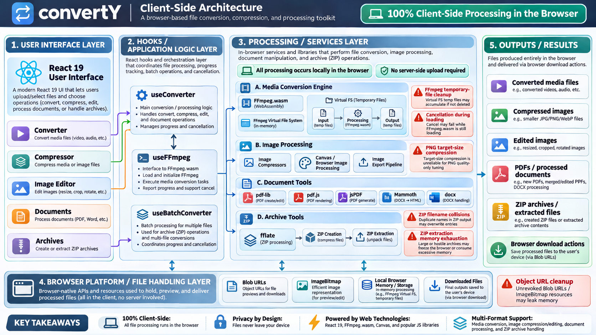

# convertY

📁 Free file converter that converts, compresses, and edits files entirely in
your browser. All processing happens client-side — **files never leave your
device**. No server, no uploads, no accounts.

## Features

- **Convert** — images, audio, and video in your browser with
  [FFmpeg.wasm](https://github.com/ffmpegwasm/ffmpeg.wasm), with a
  **batch mode** that converts multiple files one after another and downloads
  them all as a ZIP
- **Compress** — shrink JPEG, WebP, AVIF, and PNG images with a quality slider
  or a target-size mode, with before/after sizes and % saved
- **Edit** — crop (drag a rectangle on the preview), rotate in 90° steps,
  flip horizontal/vertical, and apply filters (brightness, contrast,
  saturate, grayscale, sepia) with presets
- **Documents** — merge, split, and reorder PDFs; images to PDF; PDF to
  images and text; text to PDF and DOCX; DOCX to text
- **Archives** — create and extract **ZIP** archives (ZIP only — 7z/TAR/RAR
  conversion is out of scope)
- **Drag-and-drop** — drop files directly or click to browse; visual feedback
  on hover and drag-over
- **Auto-detection** — detects file category (image, video, audio) from MIME
  type and extension
- **Format selection** — shows only compatible output formats for the
  detected category
- **Advanced options** — category-aware controls:
  - **Image**: dimensions, fit mode (contain, cover, stretch, force),
    quality, transparency preservation, background color
  - **Video**: dimensions, fit mode, frame rate, CRF quality, audio
    preservation with bitrate, GIF loop toggle
  - **Audio**: bitrate, sample rate, channels (mono/stereo)
- **Progress indicator** — real-time progress bar during FFmpeg transcoding
- **Cancel** — abort in-progress conversions
- **Preview** — native ``, `<video>`, or `<audio>` preview of the input
  file
- **Large file warning** — alerts when a file exceeds 100 MB
- **Editable filename** — output filename is pre-filled and sanitized
- **Dark mode** — full dark mode support
- **Responsive** — mobile-first layout that adapts to desktop

## Privacy

Everything runs in your browser. Files are processed locally with
FFmpeg.wasm, canvas APIs, and in-browser libraries (pdf-lib, pdf.js,
fflate) — nothing is uploaded to any server.

## Supported Formats

| Category | Inputs                              | Outputs                        |
| -------- | ----------------------------------- | ------------------------------ |
| Image    | PNG, JPEG, WebP, GIF, BMP, ICO, SVG | PNG, JPEG, WebP, GIF, BMP, ICO |
| Video    | MP4, WebM, MOV, AVI, MKV, GIF       | MP4, WebM, MOV, AVI, MKV, GIF  |
| Audio    | MP3, WAV, OGG, AAC, FLAC, M4A       | MP3, WAV, OGG, AAC, FLAC, M4A  |

> SVG inputs are rasterized to the chosen bitmap format.

### Compressor formats

JPEG, WebP, AVIF, PNG. AVIF encoding is slow on large images — the app
warns you and suggests WebP for a faster result.

### Document tools

| Operation          | Notes                                                                                     |
| ------------------ | ----------------------------------------------------------------------------------------- |
| Merge PDFs         | Combine multiple PDFs into one                                                            |
| Split PDF          | Extract page ranges (1-based, e.g. `1-2, 3-5`)                                            |
| Reorder PDF        | New page order (1-based, e.g. `3, 1, 2`)                                                   |
| Images to PDF      | JPEG/PNG images into one PDF                                                              |
| PDF to images      | Each page rendered to PNG or JPEG                                                         |
| PDF to text        | Extract text from every page                                                              |
| Compress PDF       | Structural only — re-saves with object streams; does not recompress embedded images       |
| Text to PDF        | `.txt`, `.md`, or `.html` to PDF                                                          |
| DOCX to text       | Extracts text and HTML; full-fidelity DOCX to PDF conversion is out of scope              |
| Text to DOCX       | `.txt` or `.md` to a Word document                                                        |

### Archives

ZIP only — 7z/TAR/RAR conversion is out of scope (no in-browser archiver).

## Install

Clone the repository:

```sh
git clone https://github.com/bharath-akurathi/convertY.git
cd convertY
```

Install the dependencies:

```sh
npm install
```

## Available Scripts

In the project directory, you can run:

### `npm start`

Runs the app in development mode.

Open [http://127.0.0.1:5173](http://127.0.0.1:5173) to view it in the browser.

The page will reload if you make edits.

You will also see any errors in the console.

### `npm run build`

Builds the app for production to the `dist` folder.

It correctly bundles in production mode and optimizes the build for the best
performance.

The build is minified and the filenames include the hashes.

Your app is ready to be deployed!

### `npm run lint`

Checks the code quality.

### `npm run lint:tsc`

Checks for type errors.

### `npm test`

Runs the tests.

### `npm run test:ci`

Runs the tests with coverage (the project enforces 100% coverage).

## Deploy

The app is a static site — no server is needed. FFmpeg.wasm loads its core
from the jsDelivr CDN at runtime, so the deployed site needs internet access
for conversions (compression, editing, documents, and archives work fully
offline once loaded, except the first AVIF/JPEG/WebP encoder download).

### GitHub Pages (free)

1. Push the repo to GitHub.
2. In the repository **Settings → Pages**, set **Build and deployment →
   Source** to **GitHub Actions**.
3. The included workflow (`.github/workflows/deploy.yml`) installs
   dependencies, builds the app, and deploys `dist/` on every push to the
   default branch.
4. The site is served at `https://<user>.github.io/convertY/` — the build is
   configured with `base: '/convertY/'` for this. For a custom domain, change
   `base` in `vite.config.mts` to `'./'`.

### Vercel (free, alternative)

1. Import the repository in Vercel.
2. Framework preset: **Vite**.
3. Build command: `npm run build`; output directory: `dist/`.
4. Deploy — no extra configuration is needed.

## Architecture



convertY is 100% client-side. The diagram above shows how it fits together:

- **User interface** — React 19 UI with five tools: Convert, Compress, Edit, Documents, and Archives.
- **Hooks / application logic** — `useConverter`, `useFFmpeg`, and `useBatchConverter` coordinate processing, progress, batch work, and cancellation.
- **Processing / services** — FFmpeg.wasm for media conversion, Canvas + @jsquash for image compression and editing, pdf-lib / pdf.js / jsPDF / mammoth / docx for documents, and fflate for ZIP archives. Everything runs locally in the browser; no file is ever uploaded.
- **Browser platform** — Blob URLs for previews and downloads, ImageBitmap for image work, and the FFmpeg virtual filesystem for temporary files.
- **Outputs** — converted media, compressed and edited images, PDFs and documents, and ZIP archives, all delivered as browser downloads.

## Attribution

convertY is built on
[remarkablemark/file-converter](https://github.com/remarkablemark/file-converter)
by Menglin "Mark" Xu, used under the MIT license. The original project
converts media files in the browser with FFmpeg.wasm; convertY adds image
compression and editing, document tools, ZIP archives, and batch conversion.

Read the original author's
[blog post](https://remarkablemark.org/blog/2026/08/20/file-converter-ffmpeg-wasm/).

## License

[MIT](LICENSE)
